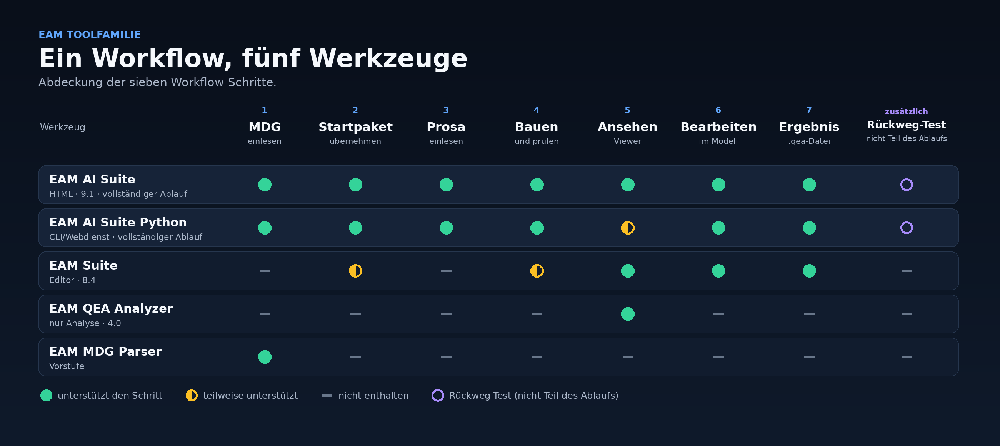

# EAM Tool-Familie

Werkzeuge für Architekturmodelle im Format `.qea`: aus Regelwerk und Beschreibung ein
geprüftes Modell bauen, vorhandene Modelle ansehen, zusammenführen und bearbeiten.

## Einstieg

**<https://mitchel85.github.io/EAM-Toolfamilie/>** — Übersichtsseite mit allen
Werkzeugen. Ein Klick lädt die Datei herunter; sie öffnet sich anschließend im Browser.

## Was ist eine `.qea`?

Eine `.qea` ist die Modelldatenbank eines Enterprise-Architecture-Werkzeugs (SQLite-Format).
Diese Werkzeuge lesen und schreiben das Format, brauchen aber kein solches Programm und
keine Lizenz.

Kurzbegriffe, die im Ablauf vorkommen:

- **MDG** — die Technologie-Datei (XML). Sie beschreibt, welche Elementtypen, Regeln,
  Sichten und Tags erlaubt sind. Sie kommt zuerst.
- **Startpaket** — eine `.qea` mit Standardelementen, die in ein Modell übernommen
  werden; die Kennungen bleiben dabei unverändert.
- **Stereotyp / 🔒** — der Typ eines Elements. Ein gesperrter Typ (🔒) wird nie direkt
  verwendet; an seine Stelle tritt ein konkreter Untertyp.
- **GUID** — die unveränderliche Kennung eines Elements. Sie sorgt dafür, dass zwei Modelle
  mit demselben Standard zusammenfinden.

## Was die Toolfamilie tut

- **Hinein:** das Regelwerk der Technologie (MDG-XML), bei Bedarf ein Startpaket mit
  Standardelementen, ein vorhandenes Modell und Text — Handbuch, Beschreibung, PDF oder Bild.
- **Heraus:** eine `.qea`-Datei mit Paketen, Elementen, Beziehungen und Tags, geprüft gegen
  das Regelwerk, gedacht für Werkzeuge, die `.qea` auswerten.
- **Wofür:** eine Architekturbeschreibung in ein prüfbares Modell übersetzen, statt sie von
  Hand nachzubauen; vorhandene Modelle verstehen, zusammenlegen und nachbessern.
- **Was sie nicht ist:** kein Ersatz für ein Modellierungswerkzeug, keine Layout-Engine.
  Substanz sind Pakete, Elemente, Beziehungen und Tags; Diagramme sind Darstellung.
- **Daten:** ohne KI arbeiten die HTML-Werkzeuge lokal im Browser. Mit KI gehen der Text
  bzw. der gewählte Modellausschnitt an den KI-Zugang, den man selbst einträgt.

## Wiederverwendung und Größe

Beides entscheidet, ob ein Modell über viele Texte hinweg zusammenwächst, statt in
Teilmodelle zu zerfallen:

- **Startpaket.** Die Standardelemente stehen mit Namen und Stereotyp im Prompt; die KI
  verwendet sie wieder, statt Dubletten anzulegen. Danach werden sie übernommen — im
  Python-Weg mit `--startpaket`, in der HTML-Fassung über das geladene Grundgerüst (bis
  300 Elemente). Die `ea_guid` bleibt unverändert.
- **Mehrere Texte.** Jeder weitere Lauf knüpft mit `--modell bestand.qea` an das Modell an:
  seine Elemente gehen als bekannter Bestand in den Prompt, das Ergebnis enthält Bestand
  und Neues. Elemente, die im zweiten Text erneut vorkommen, bleiben eine Zeile.
- **Große Quellen.** Ab 200.000 Zeichen Promptlänge baut die Python-Fassung in Abschnitten
  (`--chargen-zeichen`, Standard 120.000). Jeder Abschnitt sieht die bereits erfassten
  Elemente; die Antworten werden vor der Prüfung zusammengeführt.
- **Grenze der HTML-Fassung.** Sie hält die `.qea` vollständig im Browserspeicher und ruft
  die KI je Lauf einmal auf. Für Modelle im dreistelligen MB-Bereich und für sehr lange
  Texte ist die Python-Fassung der Weg.

## Der Ablauf in sieben Schritten

1. **MDG einlesen** — die Technologie-XML laden. Daraus entsteht das Regelwerk: Stereotype
   (auch die abstrakten 🔒), Topologie-Regeln, Viewpoints, Tag-Typen. Wie viele es sind,
   bestimmt der MDG-Stand; die Regeldatei wird laufend fortgeschrieben.
2. **ggf. Startpaket übernehmen** — Standardelemente kommen als `.qea`. Ihre `ea_guid`
   bleibt wörtlich erhalten, damit Modelle mit demselben Standard zusammenfinden.
3. **Prosa einlesen** — Handbuch, Text, PDF oder Bild. Daraus werden Elemente und Beziehungen,
   jede mit Angabe ihrer Herkunft.
4. **Architektur bauen und prüfen** — gegen die Regeln der MDG prüfen. Abstrakte Stereotype (🔒)
   werden nie instanziiert; eine Regel mit abstraktem Endpunkt gilt für alle konkreten
   Subtypen.
5. **Architektur sehen** — Viewer: Pakete, Sichten, Graph, Pfade zwischen Elementen.
6. **Architektur bearbeiten** — korrigieren (von Hand oder in Worten), Standardelemente
   nachziehen, als neue `.qea` speichern. Das Original bleibt unberührt.
7. **Ergebnis** — die `.qea` liegt vor.



- Die MDG kommt zuerst. Ohne Regelwerk wird nichts gebaut.
- Das Startpaket geht beim Bauen in den Prompt: Seine Elemente stehen mit Namen und
  Stereotyp im Modell, die KI verwendet sie wieder, statt Dubletten anzulegen. In der
  Python-Fassung übernimmt `--startpaket` den Katalog mit unveränderten `ea_guid`; in der
  HTML-Fassung wird das geladene Grundgerüst gelesen (bis 300 Elemente im Prompt).
  Nachziehen geht weiterhin mit `eam-ai toolbox`.
- Große Quellen werden geteilt: Ab 200.000 Zeichen Promptlänge baut die Python-Fassung
  in Abschnitten (`--chargen-zeichen`, Standard 120.000 Zeichen). Jeder Abschnitt sieht
  die bereits erfassten Elemente; die Antworten werden vor der Prüfung zusammengeführt.

## Welches Werkzeug wofür

- **EAM AI Suite** (eine HTML-Datei, Fassung 9.1) — die ganze Kette im Browser: MDG laden,
  Standardelemente übernehmen, Prosa mit KI in ein Modell übersetzen, prüfen, ansehen,
  bearbeiten, Handbuch erzeugen.
- **EAM AI Suite Python** (Kommandozeile `eam-ai` und Webdienst) — dieselbe Kette ohne
  Browser, für Serienläufe und Server. Für das Bauen aus Prosa braucht sie ein KI-Backend;
  ohne KI geht nur das Gerüst aus dem Regelwerk.
- **EAM Suite** (eine HTML-Datei, Fassung 8.4) — vorhandene Modelle öffnen, mehrere
  verschmelzen, von Hand bearbeiten und als neue `.qea` speichern; ohne MDG-Prüfung, ohne
  KI, ohne Prosa.
- **EAM QEA Analyzer** (eine HTML-Datei, Fassung 4.0) — vorhandene `.qea` nur lesen und
  verstehen: Explorer, Sichten, Graph, Pfade, Export als Bild oder Tabelle; schreibt nichts.
- **EAM MDG Parser** (eine HTML-Datei) — MDG-XML im Browser durchsuchen und als
  Regeldateien exportieren; baut kein Modell. Zusätzlich lässt sich der Master-Prompt des
  ehemaligen ADMBw-Extraktors als optionales Artefakt ausgeben.

Schnellwahl
- Neues Modell aus Text → EAM AI Suite (für Serien und Server: EAM AI Suite Python)
- Modell nur ansehen → EAM QEA Analyzer
- Modelle zusammenlegen oder von Hand ändern → EAM Suite
- Regelwerk nachschlagen → EAM MDG Parser

Abgrenzung
- Nur die beiden AI Suiten können den ganzen Ablauf. HTML und Python sind zwei getrennte
  Umsetzungen derselben Kette.
- EAM Suite, EAM QEA Analyzer und EAM MDG Parser sind eigenständige Einzelwerkzeuge mit
  eigenem Quellstand. Es gibt keinen gemeinsamen UI-Kern.
- Änderungen wandern nicht automatisch mit: ein Fix in der EAM Suite ist kein Fix in der
  EAM AI Suite — und umgekehrt.
- Die EAM Suite zeigt ein fest eingebautes ADMBw-Referenzraster. Es folgt einer neuen MDG
  nicht; gegen die aktuelle MDG prüfen nur die beiden AI Suiten.
- Der Open WebUI QEA Analyzer arbeitet nur auf der Tabellenstruktur der `.qea`; ein
  ADMBw-Schema bringt er nicht mit.
- Die KI-Schritte der EAM AI Suite brauchen einen KI-Zugang (Endpunkt, Schlüssel). Laden,
  Sehen und Bearbeiten gehen ohne.
- Fragen an ein Modell, nur lesend, beantworten die EAM AI Suite, `eam-ai frage` und der
  Open WebUI QEA Analyzer.
- Weitere Werkzeuge der Familie: die Prompt-Werkzeuge EAM-AI-ADMBw-Extractor, -Batch und
  -Script-Maker. Sie arbeiten mit der Wissensbasis aus der MDG; Quellen unter `apps/`.
  Der ADMBw-Extractor wird nicht ausgeliefert; sein Master-Prompt liegt beim EAM MDG Parser.

## Herunterladen

Alle Dateien liegen im öffentlichen Release.

- Übersichtsseite: <https://mitchel85.github.io/EAM-Toolfamilie/>
- EAM AI Suite:
  [EAM-AI-Suite.html](https://github.com/Mitchel85/EAM-Toolfamilie/releases/latest/download/EAM-AI-Suite.html)
  · für SharePoint:
  [EAM-AI-Suite.aspx](https://github.com/Mitchel85/EAM-Toolfamilie/releases/latest/download/EAM-AI-Suite.aspx)
- EAM AI Suite Python:
  [eam-ai-suite-python.zip](https://github.com/Mitchel85/EAM-Toolfamilie/releases/latest/download/eam-ai-suite-python.zip)
- EAM Suite:
  [EAM-Suite.html](https://github.com/Mitchel85/EAM-Toolfamilie/releases/latest/download/EAM-Suite.html)
  · für SharePoint:
  [EAM-Suite.aspx](https://github.com/Mitchel85/EAM-Toolfamilie/releases/latest/download/EAM-Suite.aspx)
- Open WebUI QEA Analyzer:
  [EAM-QEA-Analyzer.html](https://github.com/Mitchel85/EAM-Toolfamilie/releases/latest/download/EAM-QEA-Analyzer.html)
  · für SharePoint:
  [EAM-QEA-Analyzer.aspx](https://github.com/Mitchel85/EAM-Toolfamilie/releases/latest/download/EAM-QEA-Analyzer.aspx)
- EAM MDG Parser:
  [EAM-MDG-Parser.html](https://github.com/Mitchel85/EAM-Toolfamilie/releases/latest/download/EAM-MDG-Parser.html)
- Open WebUI QEA Analyzer für Open WebUI (fragt eine `.qea` ab, statt zu raten):
  [eam_qea_analyzer_openwebui.py](https://github.com/Mitchel85/EAM-Toolfamilie/releases/latest/download/eam_qea_analyzer_openwebui.py)
- Inhalt des Release:
  [RELEASES.md](https://github.com/Mitchel85/EAM-Toolfamilie/releases/latest/download/RELEASES.md)

So geht's
1. Datei herunterladen.
2. Datei öffnen — sie öffnet sich im Browser.
3. Die eigene `.qea` bzw. die MDG-XML hineinziehen.

- Die `.aspx`-Dateien sind dieselben Anwendungen für SharePoint/IIS (UTF-8 mit BOM).

### EAM AI Suite Python

```bash
unzip eam-ai-suite-python.zip
pip install ./eam-ai-suite-python
eam-ai --help
```

- `eam-ai build --mdg technologie.xml --text beschreibung.pdf --out modell.qea` — Schritte 1,
  3 und 4; braucht ein KI-Backend (`--backend openai` oder `ollama`, offline `--backend datei`).
- `eam-ai build … --modell bestand.qea` — an ein vorhandenes Modell anknüpfen: seine
  Elemente gehen in den Prompt, das Ergebnis enthält Bestand und Neues.
- `eam-ai build --mdg technologie.xml --out geruest.qea` — Gerüst nur aus dem Regelwerk,
  ohne Text, ohne KI.
- `eam-ai toolbox` — Standardelemente aus einem Startpaket übernehmen, GUID-erhaltend.
- `eam-ai merge` · `eam-ai edit` · `eam-ai korrigiere` — zusammenführen, gezielt ändern,
  in Worten korrigieren.
- `eam-ai frage` — Frage an eine vorhandene `.qea`.
- `eam-ai serve` — Weboberfläche.
- Viewer (`viewer_html.py`) und Handbuch (`handbuch_generator.py`,
  `prosa_vergleich.py`) liegen als Module im Paket; eigene `eam-ai`-Befehle dafür gibt es
  noch nicht.

## Häufige Fragen

**Ist das für interne Modelle sicher?**
Die HTML-Werkzeuge laden nichts nach und senden nichts weg; sie arbeiten ohne Netz.
Einzige Ausnahme: die AI Suiten dürfen auf Wunsch eine KI anbinden — nur wenn ein Zugang
eingetragen ist, und nur der ausgewählte Text bzw. Modellausschnitt geht dorthin.

**Warum sehe ich auf GitHub nur Text, wenn ich auf die Datei klicke?**
Weil GitHub HTML als Quelltext anzeigt. Nimm die Download-Links oben oder die
Übersichtsseite <https://mitchel85.github.io/EAM-Toolfamilie/>.

**Welche Datei ist die richtige: `.html` oder `.aspx`?**
`.html` für den eigenen Rechner. `.aspx` nur, wenn die Datei auf einem SharePoint-/IIS-Server
liegt.

**Darf ich die Dateien weitergeben?**
Ja, unverändert weitergeben ist erlaubt (MIT-Lizenz). Details in [LICENSE](LICENSE) und
[NOTICE.md](NOTICE.md).

## Für Entwickler

Aufbau
- `packages/rules/` — MDG-Leser. Welche MDG-Datei gilt, steht in einer einzigen Zeile:
  `packages/rules/CURRENT`.
- `packages/core/` — Python-Kern: lesen, prüfen, schreiben, zusammenführen, bearbeiten,
  Viewer, Handbuch.
- `apps/html-suite`, `apps/html-editor`, `apps/html-analyzer`, `apps/mdg-web` — die
  HTML-Auslieferungen, je mit eigenem Quellstand und eigenem Build; der MDG Parser wird
  byte-gleich übernommen.
- `apps/cli`, `apps/mcp`, `apps/admbw-*` — Kommandozeile, MCP und Open WebUI,
  Prompt-Werkzeuge.
- `knowledge/` — Wissensbasis, **erzeugt** aus der MDG; nicht von Hand ändern.
- `vendor/` — Browser-Bibliotheken, kanonisch; wird beim Bauen in die Apps gespiegelt
  (`apps/*/vendor/` ist nicht versioniert).

Keine festen Zahlen
- Die MDG ändert sich laufend: Stereotype, Regeln, Viewpoints und Tag-Typen kommen und
  gehen. Der Parser extrahiert immer vollständig; die Anzahl ist variabel.
- Die Zahlen eines MDG-Stands stehen in der Baseline
  `packages/rules/schemas/baseline-mdg-<release>.json` und in `knowledge/admbw-meta.md` —
  nicht in Code, README oder Prüfskript.
- Neuer MDG-Stand: XML ablegen → `packages/rules/CURRENT` anpassen → Wissensbasis neu
  erzeugen → nach fachlicher Prüfung eine neue Baseline schreiben.

Bauen und prüfen

```bash
python3 scripts/build_knowledge.py --check --check-provenance
python3 scripts/propagate.py --check
python3 scripts/build_all.py
python -m pytest -q
python3 scripts/verify_graph.py
```

- Builds sind deterministisch; `tests/test_html_artifacts.py` hält Größe, Titel,
  Funktionsmarker und die Trennung der Werkzeuge fest.
- Die große Musterarchitektur liegt bewusst nicht im Repository (Prüfsumme in
  `packages/core/ci/fixtures_manifest.json`). Ohne sie werden die Prüfläufe, die sie
  brauchen, sichtbar übersprungen. Lokal: Datei nach `packages/core/fixtures/` legen oder
  `EAM_FIXTURE_STORE` setzen; die MCP-Tests brauchen zusätzlich `MASC_QEA_PATH`.
- Regelpfad ohne KI im Quellstand: in `packages/core/` `python3 eam_suite.py --no-llm run …`.

Weiterlesen
- [docs/HERKUNFT.md](docs/HERKUNFT.md) — Herkunft der Einzelwerkzeuge und gebaute Hashes
- [docs/STRUKTUR.md](docs/STRUKTUR.md) — Struktur und Auslieferungen
- [docs/ABHAENGIGKEITEN.md](docs/ABHAENGIGKEITEN.md) — Abhängigkeitskarte (erzeugt)
- [docs/MIGRATION.md](docs/MIGRATION.md) — Migration
- [docs/ABNAHME.md](docs/ABNAHME.md) — Abnahmelauf und Prüfungen

Lizenz: [LICENSE](LICENSE) · Hinweise zu Drittkomponenten: [NOTICE.md](NOTICE.md)
