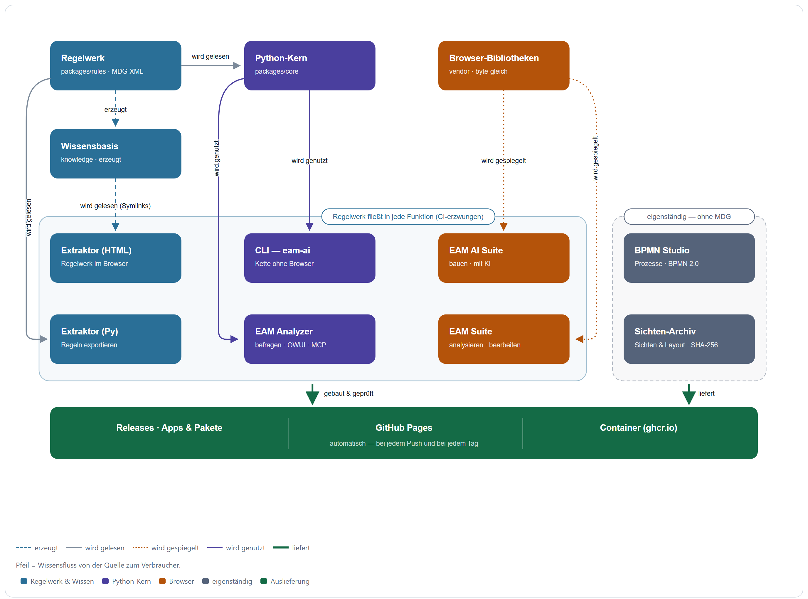

# EAM Tool-Familie

Werkzeuge für Architekturmodelle nach **NAF 4 / UAF** (Referenz-MDG: ADMBw, offen für eigene MDG-XMLs) — Architektur **erstellen**, **validieren** und **QS-fähig analysieren** in den nativen Formaten `.qea`, `.xmi` und `.json` sowie mit **ArchiMate 3.2 Exchange `.xml`** als Brücken- und Prüf-Format: niederschwellig, ohne Installation und auf Wunsch KI-gestützt. Jede Anwendung ist eine eigenständige Datei, die im Browser läuft oder sich als Paket für Kommandozeile, WebUI und MCP-Server einsetzen lässt.

## Einstieg

**<https://mitchel85.github.io/EAM-Toolfamilie/>** — Übersichtsseite mit allen Werkzeugen,
je eine Karte mit Zweck, Download und Direktlink. Ein Klick lädt die Datei; sie öffnet
sich anschließend im Browser. Viele HTML-Werkzeuge laufen dort auch ohne Herunterladen
direkt im Browser.

## Der Ablauf — und welches Werkzeug ihn trägt

Eine Architektur entsteht in einem festen Prozess. Jeder Schritt hat sein Werkzeug; Daten
und Wissensbasis ziehen sich durch den ganzen Weg — sie werden nicht gepflegt, sondern
aus **einer** Quelle erzeugt: dem Regelwerk der Technologie (MDG-XML). Daraus gehen
Stereotypen, Beziehungsregeln, Sichten und Tags hervor; dazu kommen die
Standardelemente (StEKa), die mit unveränderten Kennungen übernommen werden, damit
Modelle zusammenfinden.

| Schritt | Was passiert | Werkzeug |
|---|---|---|
| **1 · MDG rein** | MDG-XML dynamisch laden: Stereotypen, `metarelationships`, `TaggedValueTypes`, `<ModelTemplates>` & Sichten | **ADMBw Extraktor** · **EAM AI Suite** · **EAM Suite** · `eam-ai` |
| **2 · Startpaket rein** | Startpaket (StEKa, Kataloge) übernehmen — EA GUIDs, NATO GUIDs (`OriginalGUID`, `URI`, `Uuid`), `StandardElement` & `t_xref` bleiben exakt erhalten | **EAM AI Suite** · **EAM Suite** (`STDIMPORT`) · `eam-ai toolbox` |
| **3 · Prosa rein (multimodal)** | Text, Markdown, Word (`.docx` inkl. Tabellen & Bildern), PDF, Bilder (`.png`/`.jpg`) oder CSV/TSV-Tabellen — **iterativ/batchweise ohne Kontextlimit** | **EAM AI Suite** (HTML & Python) · **BPMN Studio** |
| **4 · Architektur bauen** | Native Ausgabe in `.qea`, `.xmi` (UML 2.x/1.3) und `.json`; zusätzlich Projektion nach ArchiMate 3.2 Exchange `.xml` | **EAM AI Suite** · **EAM Suite** · `eam-ai build`/`convert`/`archimate` |
| **5 · MDG-Validierung** | Dynamische Konformitätsprüfung gegen die geladene MDG-XML (Endpunkte, Metaklassen, abstrakte Stereotypen, Tags, GUIDs); für natives ArchiMate 3.2 Matrixprüfung via `archimate-check` | **EAM AI Suite** · **EAM Suite** · `eam-ai validate`/`archimate-check` · **EAM Analyzer** · **BPMN Studio** |
| **6 · QS & Zusammenhänge** | Nachbarschaft, Pfadsuche, Impact-Analyse, Waisen-Erkennung, Befund-Overlay (`Issue`) & Quellbelege (`source_ref`) | **EAM AI Suite** (`⚡ QS-Prüfung`) · **EAM Suite** (`⚡ Auto-QS`) · `eam-ai qs`/`viewer`/`graph`/`handbuch`/`ea-check` · **EAM Analyzer** |
| **7 · Sparx-EA-Sichten & Archiv** | Wahlweise Sichten gemäß MDG, Leitfaden oder Model Wizard (`--sichten`, `--wizard-dir`, Button `🖼️ Architektur mit Sichten bauen`) + SHA-256-Sichten-Archiv | **EAM AI Suite** · `eam-ai` · **Sichten-Archiv** · **BPMN Studio** |

### Metamodelle & Formate: NAF 4 / UAF vs. ArchiMate 3.2

Wichtige Abgrenzung zwischen **Dateiformat** und **Metamodell** — kurz & klar:

- **Kern-Metamodell (NAF 4 / UAF, Standard-MDG: ADMBw, offen für eigene MDG-XMLs):** Die nativen Formate **`.qea`**, **`.xmi` (UML 2.x/1.3)** und **`.json`** transportieren dasselbe Metamodell und lassen sich verlustfrei ineinander konvertieren.
- **ArchiMate 3.2 — Was die Pipeline kann:**
  - *NAF 4 / UAF → ArchiMate 3.2 exportieren:* Deterministische Projektion gemäß **NAFv4.1-ArchiMate-Guide** (dokumentierte Mapping-Tabelle in `packages/core/archimate_writer.py`); im Python-Kern (`eam-ai archimate`) geprüft gegen die **ArchiMate-3.2-Beziehungsmatrix** (`relationships.xml` aus Archi, EPL-2.0) inkl. Näherungsreport (Browser: vereinfachte Projektion ohne Matrixprüfung).
  - *Bestehende ArchiMate-3.2-Modelle einlesen & nativ prüfen:* `eam-ai archimate-check` und MCP-Analyzer prüfen nativ gegen das ArchiMate-3.2-Metamodell (7 Schichten, Beziehungsmatrix, offene Referenzen, Waisen). Im Browser laufen Ansicht, Graph, Pfade und strukturelle QS (Waisen) **ohne** NAFv4/UAF-MDG-Fehlalarme.
  - *Verlustfreier Rückweg für eigene Exporte:* Dateien aus dem eigenen Exporter (mit eingebetteten Metadaten-Properties) lassen sich verlustfrei zurück in `.qea`/IR lesen.
- **ArchiMate 3.2 — Was die Pipeline nicht kann:**
  - *Kein nativer KI-Modellbau in ArchiMate 3.2:* Die KI baut NAF 4 / UAF (bzw. die geladene MDG); ArchiMate entsteht erst beim Export als Projektion.
  - *Keine automatische 1:1-Übersetzung „fremdes ArchiMate → NAF 4 / UAF“:* Fremde ArchiMate-Dateien (z. B. aus Archi) werden nicht automatisch in NAFv4/UAF-Stereotypen umgewandelt.
  - *Keine ArchiMate-3.2-Matrixprüfung im Browser* (dafür `eam-ai archimate-check` oder MCP-Analyzer nutzen) und *keine verlustfreie 1:1-Gleichheit* zwischen UAF und ArchiMate (z. B. UAF-Ports/Parts, Default-Schichten, Viewpoints).

## Die Werkzeuge im Vergleich

Kurz, was jedes Werkzeug kann — und wie sie sich unterscheiden.

| Werkzeug | Formate | KI | Wofür es gut ist | Im Browser |
|---|---|---|---|---|
| **EAM AI Suite** (HTML) | `.qea` · `.xmi` · `.json` · ArchiMate `.xml` (Brücke) | ja (eigener Zugang, iterativ) | Die ganze 7-Stufen-Kette in einer Datei: aus Text, DOCX, PDF oder Bild iterativ ein MDG-geprüftes NAFv4/UAF-Modell bauen, direkt in Explorer/Graph/QS ansehen, per **Chat with Data** befragen, im Dialog oder per Sprache (inkl. neuer Elemente/Pakete) live weiterbauen und nach `.qea`/`.xmi`/`.json` oder ArchiMate exportieren | [öffnen](https://mitchel85.github.io/EAM-Toolfamilie/eam-ai-suite/) |
| **EAM AI Suite** (Python `eam-ai`) | `.qea` · `.xmi` · `.json` · ArchiMate `.xml` (Brücke & Matrix-QS) | ja (Backend, Batch/Stufen) | Dieselbe Kette ohne Browser — für große Quellen (Batch/Stufen 1–4), WebUI (`serve` inkl. Live-Viewer-Vorschau, **Chat with Data**, NL-Änderung/Ausbau & Prosa-Weiterbau), MDG-Validierung, ArchiMate-3.2-Projektion & `archimate-check`, QS-Kombilauf (`qs`), Viewer, Handbuch & Konvertierung | — |
| **EAM Suite** (HTML) | `.qea` · `.xmi` (UML 2.x/1.3) · `.json` · ArchiMate `.xml` (Ansicht/Brücke) | nein (bewusst offline/ohne KI) | Vorhandene Modelle laden, analysieren, verschmelzen, bearbeiten und mit `⚡ Auto-QS` gegen MDG/Waisen/GUIDs prüfen (erkennt natives ArchiMate ohne Fehlalarme; kein Neuaufbau von Grund auf) | [öffnen](https://mitchel85.github.io/EAM-Toolfamilie/eam-suite/) |
| **Sichten-Archiv** (HTML, Python) | `.qea` · `.archiv` | nein | Sichten und Layout aus einer `.qea` mit bit-identischer SHA-256-Prüfsumme auslagern und verlustfrei zurückspielen | [öffnen](https://mitchel85.github.io/EAM-Toolfamilie/sichten-archiv/) |
| **EAM Analyzer** (Open WebUI, MCP) | `.qea` · `.xmi` · ArchiMate `.xml` · `.json` | über das KI-Modell des Werkzeugs | Modelle befragen, gegen MDG validieren, Impact-/Nachbarschafts-/Pfadanalysen und umfassende QS-Prüfungen fahren | — |
| **ADMBw Extraktor** (HTML, Python) | MDG-XML · JSON | nein | Regelwerk durchsuchen und als sechs Markdown-Dateien oder maschinenlesbares JSON (`rules.json`, `stereotypes`, `aliases`) exportieren | [öffnen](https://mitchel85.github.io/EAM-Toolfamilie/admbw-extraktor/) |
| **BPMN Studio** (HTML, Python) | BPMN 2.0, PDF/DOCX/Bild, `.qea`, `.xmi`, ArchiMate `.xml`, `.json` | optional | Prozesse lesen, zeichnen, gegen 15 L4-Regeln prüfen, ADMBw-konform machen; Export inkl. BPMN-Aktivitätsdiagramm in `.qea`, `.xmi`, `.xml`, `.json`, SVG, PNG | [öffnen](https://mitchel85.github.io/EAM-Toolfamilie/bpmn-studio/) |

Der Unterschied in einem Satz: die **AI Suiten bauen** Modelle (iterativ mit KI), die **EAM Suite
analysiert, validiert und bearbeitet** sie (bewusst ohne KI), der **EAM Analyzer befragt und prüft** sie (als Werkzeug
in Open WebUI bzw. MCP), der **ADMBw Extraktor** liefert das Regelwerk und **BPMN Studio**
arbeitet an Prozessen.

**Abgrenzung.** Die HTML-Werkzeuge sind eigenständige Einzeldateien mit eigenem
Quellstand — es gibt keinen gemeinsamen UI-Kern. Die gemeinsame MDG- und Format-Schicht
liegt kanonisch in `vendor/eam-mdg.js` bzw. `vendor/eam-formats.js`. Der EAM Analyzer
arbeitet direkt auf `.qea`, `.xmi`, ArchiMate-`.xml` und `.json`. Kein Ersatz für ein
Modellierungswerkzeug ist das Ganze auch nicht: Substanz sind Pakete, Elemente, Beziehungen,
GUIDs und Tags — Diagramme sind wahlweise erzeugte Darstellung.

## Große Architekturen & Schutz vor KI-Kontextlimits

Damit auch umfangreiche Handbücher und große Architekturen nicht am Token- oder Kontextlimit eines LLM scheitern, arbeiten die KI-Pipelines iterativ:

- **HTML AI Suite (`part6_ki.js`)**: Große Eingaben werden über `zerlegeInTeile()` an `##`-Kapiteln, Absätzen und Zeilen in konfigurierbare Abschnitte (`TEIL_GRENZE = 6000`, einstellbar über `ki-charge`) zerlegt und über `inTeilenHolen()` sequentiell mit `localStorage`-Checkpoint abgearbeitet. Läuft ein einzelner Abschnitt dennoch in ein `Tokenlimit` (`finish_reason=length`), halbiert `holeAbschnitt()` ihn rekursiv und verschmilzt die Teilergebnisse über `verschmelzeAntworten()`. Bei Folgefragen im Chat werden Beziehungs- und Elementlisten gedeckelt.
- **Python-Pipeline (`extract.py`, `stufen.py`)**: `extract_batched()` teilt große Quellen in Chargen (`plan_batches`) und übergibt je Charge über `_bekannte_fuer()` maximal `known_limit = 200` relevante bereits erfasste Elemente als Kontext, sodass der Prompt nicht unbegrenzt wächst. Für sehr große Läufe trennt der Stufenlauf (`eam-ai stufe1` bis `stufe4` / `alle`) Aufnahme, KI-Chargen (mit `--pause`, `--charge` und automatischem Fortsetzen bei Abbruch), Bau und Validierung.
- **BPMN Studio**: Die Standard-Extraktion im Browser arbeitet deterministisch/regelbasiert ohne LLM-Kontextlimit. (Hinweis: Der optionale Einzelaufruf-KI-Adapter `packages/bpmn/ki.py` nutzt keine eigene Batch-Schleife — für umfangreiche Prosa-Architekturen sind `eam-ai` bzw. die `EAM AI Suite` vorgesehen.)

## Optionale Sichten (Sparx EA MDG, Leitfaden & Model Wizard)

Sichten sind in allen Pipelines optional steuerbar:

- **Python CLI (`build`, `stufe3`, `alle`) & WebUI (`serve`)**: `--sichten {aus,mdg,leitfaden,wizard}` (bzw. `--ohne-sichten` als Alias für `aus`) sowie `--wizard-dir <ordner>` für lokale Model-Wizard-XMI-Vorlagen; `view_builder.py` platziert Elemente deterministisch (`RectTop > RectBottom`) und setzt `DefaultDiagram` in `usys_system`.
- **EAM AI Suite (HTML)**: `🆕 Architektur neu bauen` startet ohne Sichten, `🖼️ Architektur mit Sichten bauen` legt die 52 ADMBw-Sichten vorab an.
- **EAM Suite (HTML, ohne KI)**: Lädt, analysiert, verschmilzt und bearbeitet bestehende Modelle inkl. vorhandener Sichten (kein Neuaufbau von Grund auf — dafür ist die **EAM AI Suite** bzw. `eam-ai` vorgesehen).
- **BPMN (`qea_bpmn.py`)**: `als_ir(..., sichten=True|False)` steuert, ob pro Prozess ein BPMN-Aktivitätsdiagramm erzeugt wird.

## Architektur — der Wissensgraph



- Jede Kante ist eine echte Beziehung — *erzeugt · wird gelesen · wird gespiegelt · wird
  genutzt · liefert*; der Pfeil zeigt den Wissensfluss von der Quelle zum Verbraucher.
- Die Zone „Regelwerk fließt in jede Funktion" ist CI-erzwungen: `scripts/verify_graph.py`
  prüft jede Kante, bevor etwas ausgeliefert wird. `BPMN Studio` und `Sichten-Archiv`
  stehen bewusst draußen (eigenständig, ohne MDG-Abhängigkeit).
- Die genauen Kanten stehen maschinenlesbar in `scripts/dependency_rules.py`, lesbar in
  [docs/ABHAENGIGKEITEN.md](docs/ABHAENGIGKEITEN.md) — erzeugt, nicht von Hand gepflegt.

## Herunterladen

Alle Dateien liegen im öffentlichen Release. Jedes Werkzeug gibt es einzeln und als
komplettes Paket (Anwendung + Kurzanleitung).

| Werkzeug | Einzeldatei | Paket |
|---|---|---|
| EAM AI Suite | [EAM-AI-Suite.html](https://github.com/Mitchel85/EAM-Toolfamilie/releases/latest/download/EAM-AI-Suite.html) · [.aspx](https://github.com/Mitchel85/EAM-Toolfamilie/releases/latest/download/EAM-AI-Suite.aspx) | [EAM-AI-Suite.zip](https://github.com/Mitchel85/EAM-Toolfamilie/releases/latest/download/EAM-AI-Suite.zip) |
| EAM AI Suite Python | [eam-ai-suite-python.zip](https://github.com/Mitchel85/EAM-Toolfamilie/releases/latest/download/eam-ai-suite-python.zip) | — |
| EAM Suite | [EAM-Suite.html](https://github.com/Mitchel85/EAM-Toolfamilie/releases/latest/download/EAM-Suite.html) · [.aspx](https://github.com/Mitchel85/EAM-Toolfamilie/releases/latest/download/EAM-Suite.aspx) · [en](https://github.com/Mitchel85/EAM-Toolfamilie/releases/latest/download/EAM-Suite-en.html) | [EAM-Suite.zip](https://github.com/Mitchel85/EAM-Toolfamilie/releases/latest/download/EAM-Suite.zip) |
| Sichten-Archiv | [Sichten-Archiv.html](https://github.com/Mitchel85/EAM-Toolfamilie/releases/latest/download/Sichten-Archiv.html) · [.aspx](https://github.com/Mitchel85/EAM-Toolfamilie/releases/latest/download/Sichten-Archiv.aspx) | [Sichten-Archiv.zip](https://github.com/Mitchel85/EAM-Toolfamilie/releases/latest/download/Sichten-Archiv.zip) |
| EAM Analyzer | [Open-WebUI-Tool](https://github.com/Mitchel85/EAM-Toolfamilie/releases/latest/download/eam_qea_analyzer_openwebui.py) · [MCP-Server](https://github.com/Mitchel85/EAM-Toolfamilie/releases/latest/download/eam-qea-mcp-server.py) | [EAM-Analyzer.zip](https://github.com/Mitchel85/EAM-Toolfamilie/releases/latest/download/EAM-Analyzer.zip) |
| ADMBw Extraktor | [ADMBw-Extraktor.html](https://github.com/Mitchel85/EAM-Toolfamilie/releases/latest/download/ADMBw-Extraktor.html) · [admbw-extraktor.py](https://github.com/Mitchel85/EAM-Toolfamilie/releases/latest/download/admbw-extraktor.py) | [ADMBw-Extraktor.zip](https://github.com/Mitchel85/EAM-Toolfamilie/releases/latest/download/ADMBw-Extraktor.zip) |
| BPMN Studio | [BPMN-Studio.html](https://github.com/Mitchel85/EAM-Toolfamilie/releases/latest/download/BPMN-Studio.html) · [.aspx](https://github.com/Mitchel85/EAM-Toolfamilie/releases/latest/download/BPMN-Studio.aspx) | [BPMN-Studio.zip](https://github.com/Mitchel85/EAM-Toolfamilie/releases/latest/download/BPMN-Studio.zip) |

Übersicht und Prüfsummen: [START-HIER.html](https://github.com/Mitchel85/EAM-Toolfamilie/releases/latest/download/START-HIER.html) ·
[RELEASES.md](https://github.com/Mitchel85/EAM-Toolfamilie/releases/latest/download/RELEASES.md) ·
[SHA256SUMS](https://github.com/Mitchel85/EAM-Toolfamilie/releases/latest/download/SHA256SUMS)

So geht's
1. Datei herunterladen.
2. Datei öffnen — sie öffnet sich im Browser.
3. Die eigene Modell- bzw. MDG-Datei hineinziehen.

`.aspx` ist dieselbe Anwendung für SharePoint/IIS (UTF-8 mit BOM). `.py`-Dateien sind für
Kommandozeile, Open WebUI oder MCP; sie werden nicht im Browser geöffnet.

## Schnell in den Werkzeugen

### EAM AI Suite Python

```bash
unzip eam-ai-suite-python.zip
pip install ./eam-ai-suite-python
eam-ai --help
```

- `eam-ai build --mdg technologie.xml --text beschreibung.pdf --out modell.qea` — bauen;
  braucht ein KI-Backend (`--backend openai` oder `ollama`, offline `--backend datei`).
  Unterstützt `--bild`, Mehrfachdateien sowie alle vier Zielformate (`.qea`, `.xmi`, `.xml`
  für ArchiMate, `.json`; `--format {qea,xmi,xml,json}` erzwingt das Format).
- `eam-ai convert --in quelle.xmi --out ziel.qea` — Konvertierung zwischen den nativen
  NAFv4/UAF-Formaten `.qea`, `.xmi` und `.json` (verlustfrei) sowie Projektion nach
  ArchiMate 3.2 `.xml` (mit Report über `eam-ai archimate`).
- `eam-ai validate --in modell.qea --mdg technologie.xml` — Architektur gegen MDG-Regeln
  (inkl. `AppliesTo`, `metarelationships`, abstrakter Stereotypen, Tags, GUIDs) prüfen.
- `eam-ai qs --in modell.qea --mdg technologie.xml --out qs.json` — kombinierter QS-Lauf
  (MDG-Validierung, Waisen-Erkennung, Quellbelege, EA-Tabellenprüfung).
- `eam-ai viewer` · `eam-ai handbuch` · `eam-ai ea-check` · `eam-ai graph` — interaktiver
  HTML-Viewer für alle 4 Formate, Betriebshandbuch-Generator, EA-Integritätsprüfung und
  Graph-Analyse.
- `eam-ai sichten-archiv {pack,unpack,verify}` — Sichten und Layout per SHA-256 aus `.qea`
  auslagern, zurückspielen und bit-identisch prüfen.
- `eam-ai archimate --ir modell.qea --out modell.xml --report bericht.json` — **Export**:
  ArchiMate 3.2 schreiben. Der Report zählt jede Näherung; `--strict` endet mit Exit 1,
  wenn Kanten offen bleiben.
- `eam-ai archimate-read --in modell.xml --out modell.json` — **Import**: ArchiMate lesen;
  das IR läuft danach durch dieselben Prüfungen und Writer wie eines aus `.qea`.
  `--strict` behandelt Warnungen als Fehler.
- **Prüfen** ohne Schreiben: dieselben Befehle mit `--report bericht.json --strict` —
  der Report nennt `unresolved`, `inverted`, `remapped`, `approximations` und die
  Paketzähler; der Rundlauf `.qea → XML → IR → XML` ist byte-identisch.
- `eam-ai archimate-check --in modell.xml --format md` — **Modellbefund**: lesen,
  zusammenfassen und prüfen (offene Referenzen, Matrixverstöße, verwaiste Elemente)
  in Text, Markdown oder JSON. `--format prompt --frage "…"` macht daraus den
  fertigen Prompt für die KI: der Befund ist die einzige Wissensquelle, Antwort
  auf Deutsch, keine erfundenen Elemente. Exit 3 bei unlesbarer Datei.
- `python -m graph laden --in modell.qea --db modell.graph.sqlite` — das Modell als
  abfragbarer Graph (SQLite): `faehigkeit`, `befunde`, `ungueltig`, `pfad`, `statistik`.
  Der Graph zeigt das Modell, wie es ist, und repariert nichts; Einzelheiten in
  `docs/GRAPH.md`.
- `eam-ai build ... --modell bestand.qea` — an ein vorhandenes Modell anknüpfen: sein Inhalt
  geht in den Prompt, das Ergebnis enthält Bestand und Neues.
- `eam-ai build --mdg technologie.xml --out geruest.qea` — Gerüst nur aus dem Regelwerk,
  ohne Text, ohne KI.
- **Stufenlauf für große Quellen** — Regelwerk, Elemente und Bau getrennt; die KI
  bekommt nur eine Charge, zwischen den Aufrufen wird gewartet, jeder Aufruf wird
  gespeichert. Ein Abbruch kostet nur die aktuelle Charge:
  ```bash
  eam-ai stufe1 --mdg technologie.xml --startpaket start.qea --text quelle.pdf --workdir lauf --projekt NSS
  eam-ai stufe2 --workdir lauf --backend openai --model deepseek-flash --pause 120 --charge 12000
  eam-ai stufe3 --workdir lauf --out modell.qea
  eam-ai stufe4 --workdir lauf --bericht pruefbericht.json
  ```
  `--pause` ist die Wartezeit zwischen zwei KI-Aufrufen (Default 120 s). Ein erneuter
  `stufe2`-Aufruf setzt an der ersten fehlenden Charge fort. `eam-ai alle …` fährt alle
  vier Stufen hintereinander.
- **Sichten steuern** — `--sichten {aus,mdg,leitfaden,wizard}` (sowie optional
  `--wizard-dir <ordner>`, oder `--ohne-sichten` als Alias für `aus`) steuert die
  Diagrammerzeugung in `build`, `stufe3`, `alle` und `serve`. Mit Sichten gilt: höchstens
  30 Elemente je Diagramm — mehr ist ein Raster, keine Aussage.
- `eam-ai toolbox` — Standardelemente aus einem Startpaket übernehmen, kennungserhaltend.
- `eam-ai merge` · `eam-ai edit` · `eam-ai korrigiere` — zusammenführen, gezielt ändern,
  in Worten korrigieren.
- `eam-ai frage` — Frage an ein vorhandenes Modell. `eam-ai serve` — Weboberfläche (inkl. `/validate`, `/jobs/<id>/qs`, `/jobs/<id>/handbuch`).

### ADMBw Extraktor (Python)

```bash
python admbw-extraktor.py technologie.xml -o rules.json --check
```

Dieselbe Datei liegt im Python-ZIP als `mdg_parser.py`; sie wird nicht doppelt gepflegt.

### EAM Analyzer (Open WebUI / MCP)

Open-WebUI-Tool: `eam_qea_analyzer_openwebui.py` unter **Werkzeuge** einfügen.
MCP-Server: beide Dateien in einen Ordner legen, dann

```bash
pip install "mcp>=1.28,<2" pandas networkx requests
python eam-qea-mcp-server.py --sse          # http://localhost:8000/sse
python eam-qea-mcp-server.py --http         # http://localhost:8000/mcp
```

Der MCP-Server importiert `eam_qea_tool.py`; die Open-WebUI-Datei muss deshalb im selben
Ordner liegen.

### Regeldateien in einem Chatbot nutzen

Der ADMBw Extraktor schreibt sechs Markdown-Dateien — reine Fachdaten, die sich in jedem
Chatbot als Wissensquelle ablegen lassen (ChatGPT, Claude, Gemini, Open WebUI, lokal).
Der Chatbot schlägt damit vor; prüfen tut er nicht.

1. Im ADMBw Extraktor die MDG-XML laden und „Alle 6" herunterladen: `admbw-knowledge-stereotypes.md`,
   `-topology.md`, `-viewpoints.md`, `-tagtypes.md`, `-stereotype-tags.md`, `admbw-meta.md`.
2. **Open WebUI:** *Workspace → Knowledge → „+“*, Dateien hochladen, Sammlung
   *ADMBw-Regelwerk* nennen; im Chat mit `#` anhängen oder beim Modell als Knowledge
   eintragen.
3. **Andere Chatbots:** ChatGPT Projekt/Custom GPT → Knowledge; Claude Projekt →
   Knowledge; Gemini Gem oder Notebook; lokal in den Kontext legen.
4. **Master-Prompt:** `ADMBw-Prompt.md` als System-Anweisung, die sechs Dateien als
   Knowledge — der Prompt sagt, wie gebaut wird; die Dateien sagen, was erlaubt ist.
5. **Grenzen:** Die Dateien sind Daten, keine Befehle. Bei Widerspruch gilt die MDG.

## Häufige Fragen

**Ist das für interne Modelle sicher?**
Die HTML-Werkzeuge laden nichts nach und senden nichts weg; sie arbeiten ohne Netz.
Einzige Ausnahme: die AI Suiten dürfen auf Wunsch eine KI anbinden — nur wenn ein Zugang
eingetragen ist, und nur der ausgewählte Text bzw. Modellausschnitt geht dorthin.

**Warum sehe ich auf GitHub nur Text, wenn ich auf die Datei klicke?**
Weil GitHub HTML als Quelltext anzeigt. Nimm die Download-Links oben oder die
Übersichtsseite <https://mitchel85.github.io/EAM-Toolfamilie/>.

**Welche Datei ist die richtige: `.html` oder `.aspx`?**
`.html` für den eigenen Rechner. `.aspx` nur, wenn die Datei auf einem SharePoint-/IIS-Server
liegt.

**Was ist eigentlich eine `.qea`?**
Die Modelldatenbank eines Enterprise-Architecture-Werkzeugs (SQLite-Format). Diese
Werkzeuge lesen und schreiben das Format, brauchen aber kein solches Programm und keine
Lizenz. Die Formate `.xmi` (offener Austauschstandard) und `.json` (für Auswertung und
Graphdatenbanken) sind gleichwertig.

**Darf ich die Dateien weitergeben?**
Ja, unverändert weitergeben ist erlaubt (MIT-Lizenz). Details in [LICENSE](LICENSE) und
[NOTICE.md](NOTICE.md).

## Für Entwickler

Aufbau
- `packages/rules/` — MDG-Leser und einzige Quelle für Regeln; welche MDG-Datei gilt,
  steht in `packages/rules/CURRENT`. Neue MDG-Stände prüft der tägliche Wächter
  (`rules-watch.yml`) und schlägt sie als PR vor.
- `packages/core/` — Python-Kern: lesen, prüfen, schreiben, zusammenführen, bearbeiten,
  Viewer, Handbuch.
- `apps/` — die HTML-Auslieferungen mit eigenem Quellstand und eigenem Build;
  `apps/cli`, `apps/mcp` — Kommandozeile, MCP und Open WebUI.
- `knowledge/` — Wissensbasis, **erzeugt** aus der MDG; nicht von Hand ändern.
- `vendor/` — Browser-Bibliotheken, kanonisch; wird beim Bauen in die Apps gespiegelt
  (`apps/*/vendor/` ist nicht versioniert).

Keine festen Zahlen
- Die MDG ändert sich laufend: Stereotypen, Regeln, Sichten und Tags kommen und gehen.
  Zahlen eines Stands stehen in `packages/rules/schemas/baseline-mdg-<release>.json` und
  `knowledge/admbw-meta.md` — nicht in Code, README oder Prüfskript.

Bauen und prüfen

```bash
python3 scripts/build_knowledge.py --check --check-provenance
python3 scripts/propagate.py --check
python3 scripts/build_all.py
python -m pytest -q
python3 scripts/verify_graph.py
```

- Builds sind deterministisch; `tests/test_html_artifacts.py` hält Größe, Titel,
  Funktionsmarker und die Trennung der Werkzeuge fest.
- Die große Musterarchitektur liegt als öffentliche Test-Fixture versioniert im Repository
  (`packages/core/fixtures/Musterarchitektur_MASC.qea`, Prüfsumme in
  `packages/core/ci/fixtures_manifest.json`). `EAM_FIXTURE_STORE` zeigt optional auf einen
  anderen Fixture-Ordner; die MCP-Tests akzeptieren zusätzlich `MASC_QEA_PATH`.
- Regelpfad ohne KI im Quellstand: in `packages/core/` `python3 eam_suite.py --no-llm run …`.
- Der Abhängigkeitsgraph (12 Zellen) wird von `scripts/verify_graph.py` geprüft und in der
  CI erzwungen; jede neue Datei braucht ihre Kante.

Weiterlesen
- [docs/HERKUNFT.md](docs/HERKUNFT.md) — Herkunft der Einzelwerkzeuge und gebaute Hashes
- [docs/STRUKTUR.md](docs/STRUKTUR.md) — Struktur und Auslieferungen
- [docs/ABHAENGIGKEITEN.md](docs/ABHAENGIGKEITEN.md) — Abhängigkeitskarte (erzeugt)
- [docs/MIGRATION.md](docs/MIGRATION.md) — Migration
- [docs/ABNAHME.md](docs/ABNAHME.md) — Abnahmelauf und Prüfungen

## Danksagung

Der EAM Analyzer baut auf den Erfahrungen und dem Code von **Markus Schmitz**
([@schmitze87](https://github.com/schmitze87)) auf — sein Projekt
[**AAroN (ArAMIS)**](https://github.com/schmitze87/AAroN) hat die QEA-Tabellenstruktur
von Sparx EA dokumentiert und als Open-Source-Prozessoren verfügbar gemacht. Ohne diese
Arbeit wäre der Analyzer nicht entstanden: danke dafür. Die QEA-Analyse in
`apps/mcp/eam_qea_tool.py` ist daraus abgeleitet; der Lizenztext (Apache-2.0) liegt im
Repository als [`apps/mcp/LICENSE-AAroN.txt`](apps/mcp/LICENSE-AAroN.txt). Details zu
Rechten Dritter stehen in [NOTICE.md](NOTICE.md).

Lizenz: [LICENSE](LICENSE) · Hinweise zu Drittkomponenten & Markenunabhängigkeit: [NOTICE.md](NOTICE.md)

> **Marken- & Unabhängigkeitshinweis:** Dieses Projekt ist ein unabhängiges Open-Source-Werkzeug und steht in keiner Verbindung zu Sparx Systems Pty Ltd oder The Open Group; es wird von dort weder gesponsert noch unterstützt. *Sparx®*, *Enterprise Architect®* und *ArchiMate®* sind eingetragene Marken der jeweiligen Rechteinhaber und dienen ausschließlich der Beschreibung unterstützter Dateiformate.

---

## Projekt unterstützen

Wenn dir dieses Projekt weiterhilft, freue ich mich über eine kleine Unterstützung:

[](https://www.paypal.com/donate/?business=michaestel%40gmail.com&no_recurring=0&currency_code=EUR)

Direkt per PayPal: `michaestel@gmail.com`