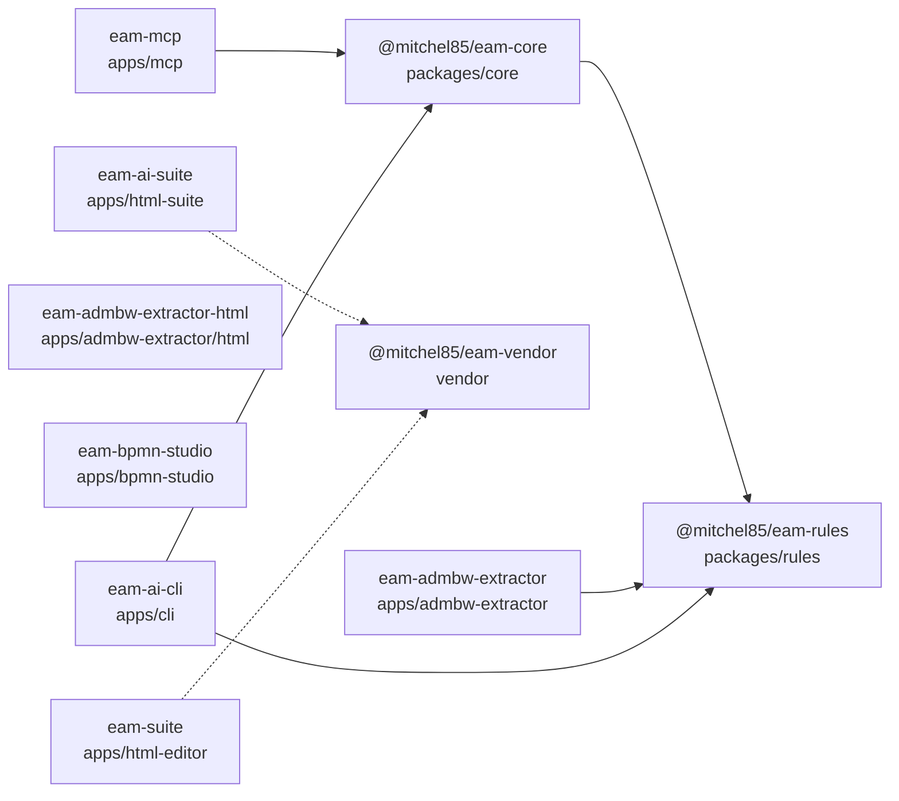

# Abhängigkeiten der EAM-Toolfamilie

> Erzeugt von `scripts/dependency_report.py`; nicht von Hand ändern.
> Prüfen mit `python3 scripts/dependency_report.py --check`.
> GitHub rendert den Mermaid-Block; lokal zeigen ihn VS Code oder Obsidian.

## 0. Graph

## 1. Zellen und Kanten

Eine Zelle ist ein Ordner mit `package.json`. `dependencies` sind Laufzeit-,
`devDependencies` sind Build-Zeit-Kanten.

| Zelle | Name | Version | Abhängigkeiten |
|---|---|---|---|
| `packages/rules` | @mitchel85/eam-rules | 2.5.0 | — |
| `packages/core` | @mitchel85/eam-core | 2.4.0 | `@mitchel85/eam-rules` |
| `vendor` | @mitchel85/eam-vendor | 1.0.0 | — |
| `apps/html-suite` | eam-ai-suite | 9.1.0 | `@mitchel85/eam-vendor` |
| `apps/html-editor` | eam-suite | 8.4.0 | `@mitchel85/eam-vendor` |
| `apps/admbw-extractor/html` | eam-admbw-extractor-html | 2.0.0 | — |
| `apps/bpmn-studio` | eam-bpmn-studio | 3.9.0 | — |
| `apps/mcp` | eam-mcp | 2.4.0 | `@mitchel85/eam-core` |
| `apps/admbw-extractor` | eam-admbw-extractor | 2.4.0 | `@mitchel85/eam-rules` |
| `apps/cli` | eam-ai-cli | 2.4.0 | `@mitchel85/eam-core`, `@mitchel85/eam-rules` |

## 2. Kanonische Quellen

| Quelle | Wird zu | Mechanik | Prüfung |
|---|---|---|---|
| `packages/rules/CURRENT` | Dateiname der aktuellen MDG | `mdg_source.py` liest die Zeile | `test_parser_einheit.py` |
| `packages/rules/NAFv4-ADMBw-MDG-2026.05.xml` | `knowledge/admbw-*` | `build_knowledge.py` | `--check --check-provenance` |
| `packages/rules/mdg_parser.py` + `documents.py` | `knowledge/admbw-*` | Parser → Dokumente | `check_single_source.py` |
| `knowledge/*` | `apps/admbw-*/` | Symlink, keine Kopie | `verify_graph.py` |
| `vendor/*` | `apps/html-*/vendor/` | `sync_vendor.py` | `sync_vendor.py --check` |
| `apps/html-*/src` + `vendor` | `apps/html-*/dist` | `build_legacy_app.py` | `test_html_artifacts.py` |
| `apps/admbw-extractor/html/index.html` | `apps/admbw-extractor/html/dist` | byte-gleiche Kopie | `test_mdg_web.py` |
| `apps/*/dist` | `dist/` | `collect_releases.py` | `test_collect_releases.py` |

## 3. Änderungsmatrix

| Änderung | Betroffen | Befehl |
|---|---|---|
| `packages/rules/NAFv4-ADMBw-MDG-2026.05.xml` `packages/rules/mdg_parser.py` `packages/rules/documents.py` `packages/rules/documents_format.py` | `knowledge`, `apps/admbw-extractor`, `dist` | `python3 scripts/propagate.py --all` |
| `knowledge/*` | `apps/admbw-extractor` | `python3 scripts/propagate.py --write && python3 -m pytest -q tests/apps` |
| `vendor/*` | `apps/html-suite`, `apps/html-editor`, `dist` | `python3 scripts/sync_vendor.py --write && python3 scripts/propagate.py --build` |
| `apps/html-suite/*` | `apps/html-suite`, `dist` | `python3 scripts/build_legacy_app.py apps/html-suite && python3 scripts/propagate.py --release` |
| `apps/html-editor/*` | `apps/html-editor`, `dist` | `python3 scripts/build_legacy_app.py apps/html-editor && python3 scripts/propagate.py --release` |
| `apps/admbw-extractor/html/*` | `apps/admbw-extractor/html`, `dist` | `python3 apps/admbw-extractor/html/build.py && python3 scripts/propagate.py --release` |
| `packages/core/*` | `apps/cli`, `apps/mcp`, `dist` | `python3 scripts/propagate.py --build` |
| `apps/mcp/*` | `apps/mcp`, `dist` | `python3 scripts/propagate.py --release` |
| `apps/admbw-extractor/*` | `apps/admbw-extractor` | `python3 scripts/propagate.py --check && python3 apps/admbw-extractor/checks/verify.py` |
| `packages/core/xmi_reader.py` `packages/core/xmi_writer.py` `packages/core/json_batch.py` | `apps/cli`, `apps/mcp`, `dist` | `python3 -m pytest -q tests/core/test_xmi_format.py tests/core/test_json_batch.py && python3 scripts/propagate.py --build` |
| `packages/bpmn/*` `apps/bpmn-studio/*` | `apps/bpmn-studio`, `dist` | `python3 scripts/propagate.py --check && python3 -m pytest -q tests/` |
| `packages/rules/*` | `knowledge`, `apps/admbw-extractor`, `apps/cli`, `apps/mcp`, `apps/html-suite`, `apps/html-editor`, `apps/admbw-extractor/html`, `dist` | `python3 scripts/propagate.py --all && python3 -m pytest -q` |
| `scripts/*` `.github/workflows/*` | `alle`, `dist` | `python3 scripts/propagate.py --all && python3 -m pytest -q` |

## 4. Vendor

| Bibliothek | SHA-256 | Suite | Editor |
|---|---|---|---|
| `vendor/LICENSE-pdfjs.txt` | `cfc7749b96f63bd3…` | — | — |
| `vendor/LICENSE-sql.js` | `60a3f6e4d7b29b43…` | x | x |
| `vendor/eam-formats.js` | `fe12fb993bffbf5b…` | x | x |
| `vendor/jszip.min.js` | `acc7e41455a80765…` | x | — |
| `vendor/pdf.min.js` | `1fc294eefda602e5…` | x | — |
| `vendor/pdf.worker.min.js` | `99732130603cd498…` | x | — |
| `vendor/sql-wasm.js` | `694ca5b36aa3e6e7…` | x | x |
| `vendor/sql-wasm.wasm` | `0734155c83e49398…` | x | x |

## 5. Wissensbasis-Verweise

10 Symlinks in den Downstream-Apps:

- `apps/admbw-extractor/ADMBw-Aliases.json` → `knowledge/admbw-aliases.json`
- `apps/admbw-extractor/ADMBw-Knowledge-Connectors.md` → `knowledge/admbw-knowledge-connectors.md`
- `apps/admbw-extractor/ADMBw-Knowledge-Stereotype-Tags.md` → `knowledge/admbw-knowledge-stereotype-tags.md`
- `apps/admbw-extractor/ADMBw-Knowledge-Stereotypes.md` → `knowledge/admbw-knowledge-stereotypes.md`
- `apps/admbw-extractor/ADMBw-Knowledge-TagTypes.md` → `knowledge/admbw-knowledge-tagtypes.md`
- `apps/admbw-extractor/ADMBw-Knowledge-Topology.md` → `knowledge/admbw-knowledge-topology.md`
- `apps/admbw-extractor/ADMBw-Knowledge-Viewpoints.md` → `knowledge/admbw-knowledge-viewpoints.md`
- `apps/admbw-extractor/ADMBw-Meta.md` → `knowledge/admbw-meta.md`
- `apps/admbw-extractor/ADMBw-Prompt.md` → `knowledge/admbw-prompt.md`
- `apps/admbw-extractor/ADMBw-Stereotypes.json` → `knowledge/admbw-stereotypes.json`

## 6. Release-Assets

| Asset | Quelle |
|---|---|
| `EAM-AI-Suite.html` | `apps/html-suite/dist/EAM-AI-Suite.html` |
| `EAM-AI-Suite.aspx` | `apps/html-suite/dist/EAM-AI-Suite.aspx` |
| `EAM-Suite.html` | `apps/html-editor/dist/EAM-Suite.html` |
| `EAM-Suite.aspx` | `apps/html-editor/dist/EAM-Suite.aspx` |
| `EAM-Suite-en.html` | `apps/html-editor/dist/EAM-Suite-en.html` |
| `BPMN-Studio.html` | `apps/bpmn-studio/dist/BPMN-Studio.html` |
| `ADMBw-Extraktor.html` | `apps/admbw-extractor/html/dist/ADMBw-Extraktor.html` |
| `admbw-extraktor.py` | `packages/rules/mdg_parser.py` |
| `EAM-MDG-Parser.html` | `apps/admbw-extractor/html/dist/ADMBw-Extraktor.html` |
| `eam-mdg-parser.py` | `packages/rules/mdg_parser.py` |
| `eam_qea_analyzer_openwebui.py` | `apps/mcp/eam_qea_tool.py` |
| `eam-qea-mcp-server.py` | `apps/mcp/mcp_server.py` |
| `eam-ai-suite-python.zip` | `packages/core` (Quellarchiv) |

